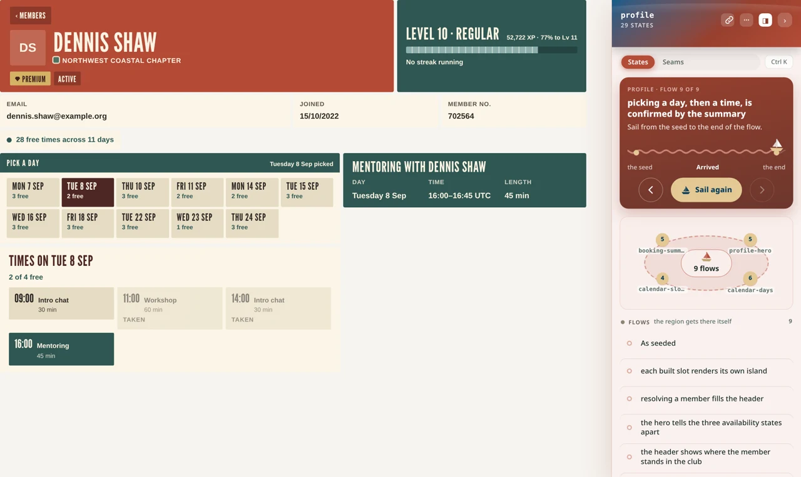
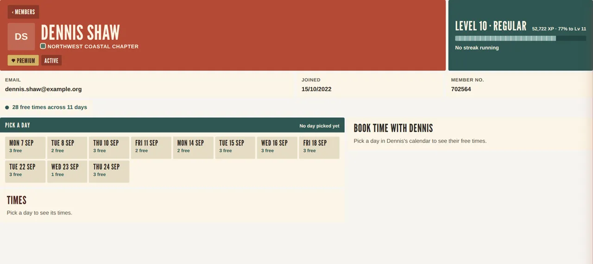

# motu

**Declare who owns each piece of a screen's state, and let the build refuse anything that breaks
it — so several people, or several coding agents, can build one screen and plug it together without
a surprise at the end.**

When a screen is built by more than one hand, each component usually works on its own. The bugs live
*between* them: two components setting the same piece of state, a component mounted in the wrong
place, a backend call nobody knew the screen made. Every component's tests pass; the screen is wrong.

motu has you write that down, once per screen, in one small file — here the demo app's events page,
trimmed:

```ts
islands: [
  { slot: 'event-filters', element: 'x-event-filters',
    writes: { 'filter-changed': 'filter' } },            // the ONLY component that sets `filter`
  { slot: 'event-list',    element: 'x-event-list',
    bind: ['events', 'filter'],                           // reads `filter`, never sets it
    writes: { 'event-selected': 'selectedEventId' } },
  { slot: 'event-detail',  element: 'x-event-detail',
    bind: ['events', 'selectedEventId'] },
],
```

— and then holds the code to it. None of that is documentation: a second component setting `filter`
is a build error, a slot the page does not have fails your typecheck, and a backend call nothing
declared fails the test that made it.

**See it live, nothing to install:** [every declared state of the demo app](https://motu.bulgarelli.dev/Scorbutics/motu-demo-app/latest/all?via=github), each at its own URL.

In 80 seconds, no sound: a booking calendar is declared on a page of the demo app, three agents build
it one component each, the checks refuse a second writer, and the same component answers from
recorded fixtures and from a real Postgres.

https://github.com/user-attachments/assets/82439fdd-7ec2-4ccf-82de-7ff1d17b0452

### The words, once

motu names a handful of things, because they need names. In plain terms:

| motu says | it means |
|---|---|
| **island** | one component on the screen that shows or does something (a filter bar, a list, a detail panel) |
| **region** | one area of a screen whose components share state — the events page above |
| **archipelago** | the file declaring a region: which island goes in which slot, who sets which key |
| **slot** · **key** | a named place in the page · a named piece of the region's shared state |
| **lagoon** | a viewer that renders every declared state of a region at its own URL |
| **host** | your application — motu lives inside it and can be removed from it in one command |

### Every state has a URL

That is the **lagoon**, and it follows from the declaration. Once a region has declared its state,
its starting values and what it asks of a backend, it renders with nothing around it — so every state
it can be in gets an address you can open in a browser, with no backend, no session and no login:

```
motu lagoon states profile
  picking a day, then a time, is confirmed by the summary · 3 step(s), &step=<n> stops earlier
    /?region=profile&flow=picking-a-day-then-a-time-is-confirmed-by-the-summary
      /?region=profile&state=profile.scenario.x-profile-hero.fully-booked
```

Open either one. It is the real components, still interactive, rendered from declared starting values
(a **seed**) — here the
first, from the demo app's member profile, with the lagoon's panel pinned beside it:



A flow is a list of such addresses, one per step. The same flow, `&step=1` to `&step=3` — pick a day,
pick a time, the summary confirms it:



And before you know what to assert, ask a region what happens — each step's keys, slots and calls,
in about five seconds:

```
motu lagoon try events 'click Coastal walk and talk'
  key   selectedEventId: "…-000000000006" → "…-000000000004"
  slot  event-detail: SOCIAL NORTHWEST COASTAL CHAPTER COASTAL WALK AND TALK Saturday 12 September …
```

### Try it live!

- The demo app's lagoon, public — every state, every flow: https://motu.bulgarelli.dev/Scorbutics/motu-demo-app/latest/all?via=github
- The demo app itself, the same components over a real Postgres: https://sandbox.bulgarelli.dev

### Does it catch anything?

Six **coupling** defects — every part individually correct, the composition wrong — injected into a
real app (shlink). Method and caveats in [`bench/coupling/RESULTS.md`](bench/coupling/RESULTS.md).

```
           tsc  motu-types   lint   tests    motu  motu-rt
  C1         ✓       ✓         ✓       ✓       ✓       ·   the two islands are placed in each other's slots
  C2         ·       ✓         ·       ·       ✓       ✓   a second island claims a key another produces
  C3         ·       ✓         ·       ✓       ✓       ✓   a slot name typo in the page
  C4         ·       ·         ·       ✓       ·       ✓   the reader stops binding the key it reads
  C5         ·       ✓         ·       ✓       ·       ✓   a declared write wired to an event the island never emits
  C6         ·       ·         ·       ✓       ✓       ·   the region is composed but never wrapped
```

**motu caught 6 of 6; the app's own tooling caught 5 of 6.** shlink has a test that renders the whole
page, and that sees composition. So the honest claim is:

> a page-level integration test catches most coupling defects; motu is that test, declared instead of
> written, plus one class the test cannot see.

That class is **two islands claiming one key**: nothing renders differently, the store just has two
writers and no owner. Caught statically, in about a second.

### The loop this is built for

    an agent builds a region        declared: who owns which key, which island fills which slot
      ↓
    the lagoon serves it live       every state at its own URL, on a shared host
      ↓
    a human looks — and so does     the URL is the handover; a passing check is not
    a fresh agent
      ↓
    integrate, with the checks      slots typed against the page, one producer per key, removable

Ownership is declared so several agents can build one screen at once — the archipelago IS the claim
registry, and a second claim on a key fails in that agent's own branch. The final look is
deliberately not the author's: an agent that invented something holds it in context as a premise, so
the reader is a human or a fresh agent given only the URL. A run with new snapshots says **`LOOK`**,
not `PASS`, and a check that could not run exits `2` — retry, do not repair.

### What motu is not

Not a component workshop. Storybook's unit is a **component** and its product is a **catalogue**: a
component in a state you wrote. motu's unit is a **region of a page** and its product is a
**declaration of ownership the build enforces** — then checked against the real page
(`motu integrate check`), with flows that must be able to fail and backend calls that must be
declared. A catalogue has no notion of who owns a piece of state, so nothing tells it when a second
writer appears. The two are complementary; for a design system, Storybook is strictly better.

Not a test runner either. motu checks **composition**; your components' own logic still needs unit
tests, and cross-page behaviour through a real backend still needs an integration suite. The whole of
motu is removable in one command (`motu removal-check`), and proves it.

## Where it pays

Per **screen**, not per app: a screen where several components share state, touched by more than one
person — or more than one agent — in a codebase that will outlive the current roadmap. Not a
design-system repo, not a prop-drilled tree with no coupling pain.

## What it runs on

> **Status:** early. Used daily, MIT licensed. On npm as `@motujs/cli`; a checkout still works.

| Stack | Evidence |
|---|---|
| **Next.js** | `host-app` (motu's own UI, daily), three cold-start adoptions of [Formbricks](https://github.com/formbricks/formbricks) |
| **Vite + React + TS** | `review-console`, [Novu](https://github.com/novuhq/novu)'s dashboard, a metadata-driven app (Twenty) |
| **AngularJS 1.x** | islands written in AngularJS mount like any other — `demo-app` runs one beside its React islands; [migrating a legacy app](docs/14-ocean-migration.md) |

- **Required:** React 18+, TypeScript, a real `node_modules` (no Yarn PnP), Next (webpack, not
  Turbopack) or Vite as the host bundler. Running from a checkout instead of npm, npm projects run
  `motu link` once.
- **Not supported:** Angular 2+, Vue, Svelte, Solid, Lit, plain-JS React, pages with no JavaScript
  layer. Islands are custom elements, so nothing in the core forbids another framework — but none
  has an adapter, and there is no partial path. Your backend language does not matter; what renders
  your components does.

If your stack is not in the table, assume it does not work yet.

## Try it

Requires **node >= 20.11**.

```bash
cd ~/dev/my-app                  # a Vite or Next app
npm i -D @motujs/cli             # pulls the @motujs/* packages and the lagoon's build tools
npx motu init . --host vite      # or --host next; records @motujs/* in package.json, installs the agent skills
npm install                      # once, for what init recorded
npx motu archipelago init directory
npx motu island create phone-display --from '@/components/phone-display'
npx playwright install chromium  # once, for the runtime checks
npx motu island verify phone-display --runtime
npx motu lagoon serve
```

Working on motu itself, or want the framework's source under your project? Run it from a checkout
instead (needs git; `motu` lands on your PATH):

```bash
git clone https://github.com/Scorbutics/motu.git
cd motu && ./install.sh          # deps + build + link `motu` onto PATH + install the agent skills
cd ~/dev/my-app && motu init . --host next   # then the same commands, without `npx`
```

`--from` takes the specifier the app itself uses and writes only a mount point — on a React host an
island *is* the app's component; nothing is forked. `motu lagoon publish --remote` then puts it on a
lagoon host as a link anyone can open, phone included.

The demo, **The Motu's club** — six screens over a real Postgres, one left as plain React on purpose
— is in [`demo-app/`](demo-app/RECORDING.md).

## Documentation

- [Design and limits](docs/15-design-and-limits.md) — why it does not flake, the two tiers, cost,
  what it cannot do, non-goals, known limits.
- [Concepts](docs/01-concepts.md) — island, archipelago, lagoon, region, slot, key.
- [Getting started](docs/02-getting-started.md) — `motu init` to a working lagoon.
- [Everything else](docs/README.md) — CLI, configuration, checks, lagoon, evidence, hosts, agents.

## License

[MIT](LICENSE).
